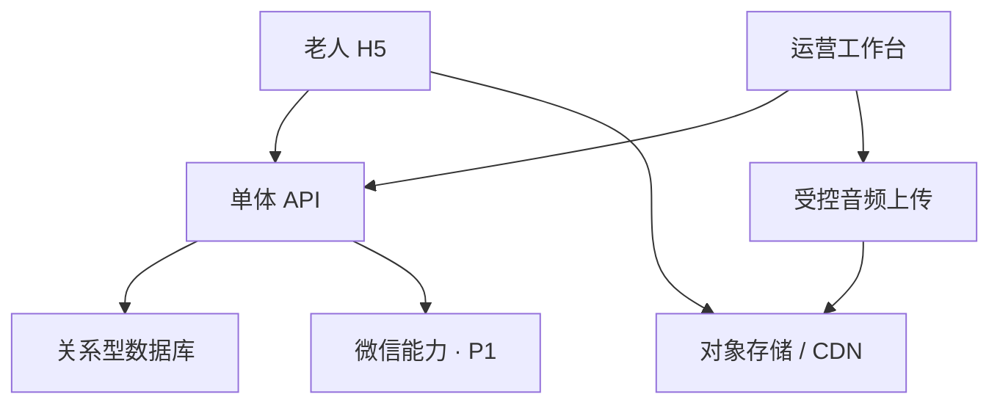

# 声音时间机器｜前后端开发说明

版本：v0.1｜日期：2026-10-11｜建议实现基线，需在 W1 根据现有团队与代码仓库确认。

## 1. 技术方案与边界

本任务尚未提供代码仓库、服务器或现有技术栈。建议采用熟悉的 TypeScript Web 技术栈：H5 单页应用、单体 HTTP API、关系型数据库、对象存储与 CDN。前端可选 React 或 Vue 之一；有现成项目时沿用现有框架，不为本次 MVP 迁移。具体依赖版本在开工时锁定，不在规划文档中假定最新版本。

不拆微服务，不引入向量检索、实时推荐、消息队列或在线 AI 生成。运营工作台与用户 H5 可同仓库但使用独立路由和服务端权限。报表先用数据库聚合与 CSV 导出，不开发复杂 BI 系统。

音频字节由媒体存储分发，不通过应用接口逐字节代理。API 返回经过上架检查的媒体信息。浏览器采用单个全局 HTMLAudioElement，复古外壳不改变播放器真实状态。

## 2. 模块与责任分工

| 模块 | 前端负责 | 后端负责 | 依赖与完成条件 |
|---|---|---|---|
| 身份与偏好 | 初始化、偏好 UI、本地恢复、退出清理 | 游客凭证、偏好持久化、清除请求 | 身份来自可信 cookie，不接受客户端自报 user_id |
| 内容与频道 | 只展示可用矩阵、节目详情、空态 | 上架内容、来源标识、可用组合、候选筛选 | 运营发布后可读取，下架即时移出候选 |
| 选播 | 保存 queue_id、应用返回结果、竞态取消 | 服务端队列、去重随机、库存变化处理 | 多次请求不发生标题和音频串台 |
| 播放 | 状态机、进度、事件监听、故障恢复 | 发放媒体地址、记录播放尝试与进度 | 成功由媒体事件确认，不由接口 200 确认 |
| 喜欢／反馈 | 乐观更新与回滚、曝光控制 | 幂等收藏、反馈去重、频控 | 点击行为与收藏最终状态分别存 |
| 分享 | 链接、分享指引、复制及错误兜底 | 节目落地元信息、P1 签名 | 不把配置成功记为已发送 |
| 微信（P1） | 用户触发跳转、回到原页、状态展示 | OAuth 换取身份、会话、游客绑定、SDK 签名 | 凭证仅服务端保存，依赖账号核验 |
| 内容运营 | 简单表单、试听、草稿错误提示 | 上传许可、校验、审核发布、审计 | 游客无法调用运营写接口 |
| 数据 | 播放事实、动作与曝光采集 | 校验、去重、聚合、导出 | 固定事件集可以复算指标 |

建议逻辑目录：`web/pages`、`web/player`、`web/api`、`web/analytics`、`admin`、`server/content`、`server/identity`、`server/playback`、`server/analytics`、`contracts`。这是模块划分建议，不要求按此新建仓库。

## 3. 选播与队列规则

1. 过滤条件为已发布、音频就绪、未超出可用日期、匹配当前年代／类型。`all` 表示该维度不限，不是实际数据库枚举值。
2. 今日电台进入时采用已保存偏好，首访采用全开放范围的首播池；用户主动在年代页确认时创建临时范围队列。
3. 队列由服务端保存，按候选 ID 洗牌，逐条取出。多条候选时不与当前节目立即重复；一轮结束后重新洗牌，避开上一轮最后一条作为新一轮第一条。
4. 队列项消费前重新检查上架状态。新上架内容下一轮进入；下架内容立即跳过。
5. 无候选返回 `NO_CONTENT`，不能悄悄跨类型或年代；只有一条且是当前节目，返回 `NO_ALTERNATIVE`，用户可明确重听或改选。
6. 创建／下一条请求都带 `request_id`，服务端对同一队列同一 request_id 幂等。前端切换选择时递增 generation，只应用最新结果；即使旧请求返回也不能覆盖新选择。
7. 队列会话内有效，过期后按原筛选范围重新创建，不要求跨设备共享；游客、账号均不能读取他人队列。

不基于当前微小样本自动改变推荐权重。收听偏好统计不反向影响试点流量，否则会强化库存差异并干扰验证。

## 4. 播放器状态机

| 当前状态 | 触发 | 下一状态／动作 |
|---|---|---|
| idle | 元数据加载完成 | ready，显示开始按钮 |
| ready／paused | 用户点击播放 | 创建 attempt_id，调用 play，loading |
| loading | `playing` 且时间开始推进 | playing；每个 attempt 只记一次 play_started |
| loading | play Promise 被策略拒绝 | blocked，显示点击开始；不循环调用 |
| playing | 用户暂停或媒体暂停 | paused；结算真实时间增量 |
| playing | waiting／stalled | buffering；停止有效时长累计 |
| buffering | playing 且时间推进 | playing；不重复记同一 attempt 的开始 |
| 任意有音频状态 | error／明确超时 | error；给重试／换节目 |
| playing | ended | ended；结算后按规则请求下一条 |
| 非销毁状态 | 确认换台 | 停旧音频并结算，载入新源，loading |

`playback_id` 表示一次对某节目的收听生命周期：同会话暂停恢复仍为同一个；换节目、明确重听或新打开时创建新的。`attempt_id` 表示一次启动／恢复尝试，技术成功率按尝试统计。媒体缓冲恢复不额外产生用户尝试。

首个数据／启动建议 10 秒超时，弱网单列；播放中缓冲建议 15 秒后显示恢复选项。每次失败最多自动重试 1 次且不绕过策略限制，其后由用户决定；同队列连续 3 条媒体失败停止接播并展示错误。

页面切换不创建新的 audio。所有异步回调校验当前 generation 与 playback_id；移除旧事件监听，避免重复累计。音效与节目必须避免重叠；音效失败直接跳过。

本期不保证后台或锁屏永久持续播放。真机记录平台实际行为；发生系统中断后如实呈现暂停及可恢复入口。暂停／来电／蓝牙切换时以媒体事实为准，不以“页面还开着”推断在听。

## 5. 有效收听时长与事件

前端在播放时每约 1 秒取样 media currentTime 和单调时钟，只有处于 playing、未静音、时间正向推进且没有 seeking 的区间可计入。有效增量取可验证媒体推进与墙钟增量的较小值；采样间隔大于 5 秒的空档不追补，以免将系统挂起误算为播放。浏览器不知道设备外部音量，因此不能断言用户听见。

每约 10 秒上报累计有效毫秒数 `cumulative_listen_ms`、累计可验证墙钟毫秒数 `observed_wall_ms`、当前位置、`seq`。暂停、换台、结束时再发送一次。隐藏页有正常短间隔采样可继续计；浏览器节流导致缺样则保守漏计，并在报表标注后台测量限制。

服务端按 playback_id 记录最大 seq 与单调累计值，只接受新增进度；累计有效值不得大于累计可验证墙钟值，亦不得超过服务端本播放已历经时间加容忍值。重复／倒序包不重复加时长，不信任前端任意秒数。MVP 不支持倍速或拖动；若未来增加需要重新定义计量规则。

页面退出发送仅是尽力操作；事件先入有限本地队列，可重试最多 24 小时，event_id 不变。身份退出／切换／清除时停止旧队列上传并清除账号事件，避免算到新账号；最后一段可能丢失，不追求无法保证的浏览器关闭必达。

关键事件：session_open、content_impression、play_attempt、play_started、play_blocked、play_error、play_progress、play_end、channel_change、like_click、like_set、feedback_impression、feedback_submit、share_click、share_copy、share_landing。技术错误与用户动作分开；IP、授权 code、token 不进入事件 payload。

## 6. 游客、微信与收藏

P0：服务端生成随机游客主体和有签名／不可预测的会话凭证，使用安全 cookie；偏好／收藏归主体所有。localStorage 仅缓存 UI 所需信息，不作为服务端权限依据。拒绝非必要分析后仍保留提供播放和收藏所需最少状态，分析事件不入库；报表给出可测样本人数与退出分析人数。该状态下停发分析心跳，播放／队列凭证仅用于提供当次服务并短期失效，不保留可关联的长期收听历史；反馈触发改用本地计时，明确提交的反馈仍可保存，不计入行为率报表。统计可测覆盖情况只保留必要汇总，不借覆盖率追踪拒绝分析者。

P1：在 W1 核验公众号身份、网页授权能力、回调域名、JS 安全域名、线上 HTTPS 与 SDK 条件。仅写出待核验接入路径，不能假设任意账号已有权限。

用户点击登录后，服务端生成短期一次性 state，回调验证 state 并服务端交换身份；return_to 只允许站内路径。使用安全 cookie 建立会话；不把密钥、长期 token、原始外部身份标识发送给前端。

合并规则：当前游客只可在有效绑定会话下绑定到本次账号；收藏取并集；已有账号偏好优先，账号无偏好才导入游客偏好；收听原始事件不复制，使用受控身份映射聚合。事务与幂等保证回调重试不重复。一个游客主体一旦归属某账号，不可再归给另一账号。退出后创建全新游客，防止公用设备串数据。

微信共享身份应按 app_id＋openid 标识，不假设 unionid 一定存在。游客绑定后历史留存报表应按固定报表版本统一重算，不能今天分母合并、昨天分子未合并。

喜欢为可取消的唯一关系；点击用于行为分析，收藏数使用当前有效关系计算，不把每次点击累加成收藏数。没有登录不应拦截喜欢。

## 7. 内容管理与音频准备

工作流：上传资源 → 填写内容与来源 → 试听与年代核查 → 审核 → 发布 → 必要时下架。运营至少有 editor 与 reviewer/admin 两类权限；试点团队小可以同人兼任，但审计仍记录操作者和时间。

建议音频交付统一 MP3、合理码率、音量均衡且无明显爆音；具体编码参数在真机验证中确认。后端读取真实文件元数据生成 duration_ms，不相信表单手填的“20分钟”。限制文件大小与格式，上传只允许受控对象路径；不做任意外链抓取。

发布校验：标题、年代、类型、来源类型、资料引用、使用依据、审核信息、音频就绪、实际时长齐全；新闻资料及播稿事实经人工核查。来源含事件、作品或音频出处，不要求编造未知录制年份。AI 重制额外记录审核播稿版本、生成标识，节目 UI 保持可见提示。

音频建议使用短期媒体 URL，播放开始前验证上架状态；默认建议有效 30 分钟，较长音频开始前确保有效期覆盖所需请求，过期刷新时不得新开 playback。下架同步清候选与 CDN 可控缓存；已签发地址的残余可用窗口必须记录，紧急下架可撤销／删除对象。本方案不能保证已下载副本远程消失。

## 8. 安全、数据和运行配置

- HTTPS，同源 API 优先；安全、HttpOnly、合适 SameSite 的会话 cookie；写请求做 CSRF／来源校验；运营另设鉴权和限流。
- 客户端只提交资源 ID，服务端从会话解析主体，校验收藏、队列、播放记录的归属。
- 数据库只存必要资料；外部账号标识和应用密钥不进入普通日志；不采集手机号、联系人、位置或设备指纹。
- 建议原始分析事件保留 90 天、去身份聚合 180 天；是待产品确认的内部策略，不是法律期限结论。清除我的数据创建可追踪删除任务，账号／游客均有入口。
- 建议每日备份，开发／测试／生产分离；运营动作审计和错误日志按权限访问；恢复演练使用测试数据。
- 配置项：开放年代与类型、首播池、音效开关、微信开关、反馈频率、业务时区、数据保留周期、媒体有效期。密钥仅环境配置，不提交仓库。

## 9. 联调与测试矩阵

| 类型 | 必测内容 | 通过标准 |
|---|---|---|
| 规则测试 | 0／1／多条队列、洗牌边界、下架、重复请求 | 不跨范围、不重复消费、不选择未发布 |
| 身份测试 | 跨主体读写、退出、游客绑定重试 | 不能越权，不串账号；绑定幂等 |
| 数据测试 | 心跳重试、乱序、暂停、拖时钟、退出缺尾 | 不多计时长；样例数据报表可复算 |
| 用户流程 | 首播、换台、收藏、反馈、分享落地、清除 | 每条有成功与失败恢复路径 |
| 真机 | iOS 微信、Android 微信、iOS Safari、Android Chrome | 记录实际 OS／浏览器版本；核心 P0 通过 |
| 设备与网络 | 至少一部目标人群低性能机、小屏、字体放大、Wi-Fi／移动网络／弱网／断网 | 无布局遮挡；超时有反馈；不卡死 |
| 媒体中断 | 切页、前后台、锁屏、来电、耳机连接、快速切换 | 状态与真实播放一致；不叠音、不虚计 |
| 运营 | 上传失败、校验失败、上架、下架、导出 | 权限正确，数据字段完整，错误可理解 |

建议技术目标：指定真机与正常网络下，用户点击到真实开始 P95 ≤3 秒；点击成功率 ≥95%。评测记录样本量、设备与网络，不用开发机单次结果声称达标。小规模试点容量先按约 50 同时在线、最多每人 10 秒一条心跳规划，再按实际部署做针对性检查；这不是已验证的性能结论。

## 10. 发布与完成定义

代码合入前完成主要业务规则测试与接口联调，测试环境用虚构用户和明确标记的内容；事件中带 environment，生产报表排除测试。

发布产物包括：H5 与 API 构建物、数据库迁移、环境配置清单、20 条内容清单、真机验收记录、指标查询／导出说明、运营使用说明和回滚步骤。先部署可向后兼容的数据库与 API，再部署前端；保留上一版构建并演练回滚。破坏性数据库清理不与首次上线同批执行。

完成定义：01 的 P0 门槛通过、02 的页面与错误态齐全、04 的接口和口径可以对账，且内容与运营责任人能够日常发布、下架和查看反馈。微信 P1 未交付时，发布说明和页面文案必须同步反映。

## 11. 外部依据与待核验项

已查阅：MDN Autoplay guide，https://developer.mozilla.org/en-US/docs/Web/Media/Guides/Autoplay ，说明有声自动播放可能被浏览器阻止；因此播放器设计必须捕获失败并提供点击入口。

待开工核验的官方入口（本次未成功读取内容）：

- 微信网页授权：https://developers.weixin.qq.com/doc/offiaccount/OA_Web_Apps/Wechat_webpage_authorization.html
- 微信 JS-SDK：https://developers.weixin.qq.com/doc/offiaccount/OA_Web_Apps/JS-SDK.html

其余架构、阈值与保留周期为本项目建议方案；部署地区、账号具体权限和上线所需手续由负责人按实际环境确认。
